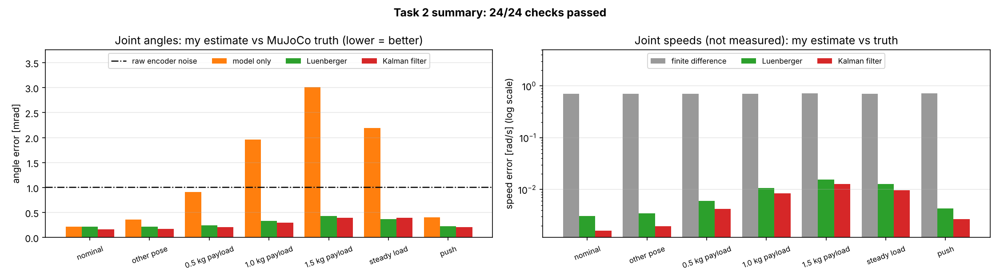

# step4_Sameeha_Work: Task 2, modelling and state estimation

My part of the project: a state-space model of the UR3e, checking it's controllable and observable, and an observer that takes the 6 noisy joint encoders and works out all 12 states (6 angles + 6 speeds), $\hat x = [\hat q;\ \hat{\dot q}]$. Yara's controller (Task 3) is meant to use this estimate instead of MuJoCo's true values.

## Files (run in this order)

Run from the repo root with the `.venv` active, or press ▶ on each file in VS Code. Each step prints its results and saves its graphs in `results/`.

| File | What it does | Criterion |
|---|---|---|
| `step1_state_space_model.py` | sets up the state, input and output, shows $M(q)$ changes with pose, builds the textbook model and **the MuJoCo model I actually use**, checks it against MuJoCo | A |
| `step2_controllability_observability.py` | rank tests, Gramians, PBH test, and what happens if a sensor is lost | A |
| `step3_measurement_and_ground_truth.py` | encoder noise model, MuJoCo sensor timing, and the test motion I grade everything against | B / C |
| `step4_observers.py` | finite difference vs Luenberger vs Kalman filter (+ a Kalman filter with no model) | C |
| `step5_evaluation.py` | compares the estimates with the true values: graphs, ±2σ bands, error table (`.csv`), NEES | C |
| `step6_tuning.py` | picks the observer settings using a mix of test situations, and tests different encoder quality | C |
| `step7_robustness.py` | push, unknown payload, 20 random trials, re-linearising the model | E |
| `observer.py` | **the finished Kalman filter that `main.py` will import**. Running it tests it in a copy of the `main.py` loop | n/a |
| `step8_testing.py` | **24 automatic PASS/FAIL checks** of everything above, plus a summary graph and report | all |
| `run_all.py` | runs all of the above in order and says PASS/FAIL for each (about 1 minute) | n/a |

## Testing

To test everything at once, from the repo root:

```
python step4_Sameeha_Work\run_all.py
```

It runs steps 1-7, `observer.py` and `step8_testing.py`, saves all the graphs in `results/`, and the last line should say `RESULT: 24 / 24 checks passed`. To run only the checks: `python step4_Sameeha_Work\step8_testing.py`.

Each check has a fixed pass mark based on what the task needs. I didn't pick them to make the code pass. The main one is **"angle error below the raw encoder noise"**: if the observer can't beat just reading the encoder, there's no point having it. The full table gets saved to `results/step8_test_report.md` every time it runs.

| Area | What gets checked |
|---|---|
| Modelling (A) | my linear model matches MuJoCo (>= 95 %), the arm holds still at home, the model is stable, controllable + observable (both models), detectable + stabilisable |
| Sensing (B) | the encoder noise matches the $R_n$ the filter uses, and the same seed always gives the same data |
| Estimation (C) | the KF beats the raw encoder, is at least 50x better than finite difference and better than Luenberger on speed; every joint < 0.01 rad/s; >= 95 % of errors inside its own ±2σ |
| Robustness (E) | other pose, 1.5 kg payload, steady load, push (and recovering after it), 20 random trials; the KF beats "model only" whenever there's a load |
| Integration | `observer.py` gives exactly the same answers as step 4, works with `main.py`'s `update(sensordata, ctrl)` line, takes < 2 ms per update, gives a clear error if the sensors are missing |

The `main.py` check adds the encoder sensors inside the test only, so `environment.py` and `main.py` aren't changed.

## Results

**24 / 24 checks passed.** The encoder noise is 1.006 mrad, dt = 2 ms, and the observers always use the normal model (linearised at home), even when the real robot is different.



**Joint angles** (my estimate vs the MuJoCo truth, RMSE in mrad; raw encoder noise = 1.006):

| Test | model only | Luenberger | **Kalman filter** |
|---|---|---|---|
| normal | 0.218 | 0.213 | **0.165** |
| other pose | 0.360 | 0.217 | **0.170** |
| 0.5 kg payload | 0.911 | 0.248 | **0.205** |
| 1.0 kg payload | 1.959 | 0.332 | **0.294** |
| 1.5 kg payload | 3.007 | 0.429 | **0.394** |
| steady load | 2.188 | 0.367 | **0.393** |
| push | 0.405 | 0.227 | **0.209** |

**Joint speeds** (never measured; RMSE in rad/s):

| Test | finite difference | Luenberger | **Kalman filter** |
|---|---|---|---|
| normal | 0.709 | 0.0031 | **0.0016** |
| 1.0 kg payload | 0.712 | 0.0108 | **0.0085** |
| 1.5 kg payload | 0.713 | 0.0156 | **0.0128** |
| steady load | 0.712 | 0.0127 | **0.0097** |
| push | 0.719 | 0.0043 | **0.0027** |

**20 random trials** (start pose moved up to ±0.5 rad, payload 0-1 kg): KF angle error median 0.214 mrad, worst 0.275 mrad.

**What this shows**

1. **The Kalman filter's angle estimate is better than the raw encoder in every test,** about 2.5-6x better than just reading the encoder.
2. **The speeds, which are never measured, are 50-440x more accurate than finite difference** (0.0016-0.013 rad/s vs about 0.71 rad/s).
3. **The encoders are what make it work when things change.** "Model only" (just the model, no encoder correction) is fine when the model is right, but once there's a load its angle error goes up to 3 mrad and stays there. The KF stays under 0.4 mrad.
4. **Limits:** the KF assumes small random disturbances, so with a steady load Luenberger is slightly better on angle (0.367 vs 0.393 mrad), and during a sudden push the KF reacts slower (step 7). Re-linearising the model as the arm moves didn't help, because the stiff servos mean one model is enough (step 7, E.4).

The graphs from each step (`step1_*.png` … `step7_*.png`) are also in `results/`.

## Packages

```
pip install -r step1_Main/requirements.txt     # updates .venv to the team's versions
pip install scipy control                      # only needed for steps 4-7
```

`observer.py` only needs numpy and mujoco, so `main.py` doesn't need anything new.

## Integration (for later, not done yet: needs a change to the shared `environment.py`)

`main.py` calls `observer.update(data.sensordata, data.ctrl)`, but the scene **doesn't have any sensors yet**, so `data.sensordata` is empty. This needs adding to `build_scene()` in `step1_Main/environment.py`, just before `return spec.compile()`:

```python
    # encoders for the observer (Task 2, step4_Sameeha_Work): one jointpos sensor per arm joint
    for j in ["shoulder_pan_joint", "shoulder_lift_joint", "elbow_joint",
              "wrist_1_joint", "wrist_2_joint", "wrist_3_joint"]:
        spec.add_sensor(name="enc_" + j, type=mujoco.mjtSensor.mjSENS_JOINTPOS,
                        objtype=mujoco.mjtObj.mjOBJ_JOINT, objname=j)
```

(`environment.py` can't import `observer.py` to do this, because `observer.py` already imports `environment.py` and that would be a circular import.)

Then the three observer lines in `main.py` just need uncommenting. They work as they are:

```python
from step4_Sameeha_Work.observer import JointObserver
observer = JointObserver(model)
x_hat, P = observer.update(data.sensordata, data.ctrl)      # x_hat[:6] = angles, x_hat[6:] = speeds
```

`observer.update` has to stay **before** the controller sets `data.ctrl`, which is already how `main.py` is laid out. After `mj_step`, `sensordata` is one step old and `data.ctrl` is the command used during that step. The observer takes care of both and gives the estimate for *right now*.

## My settings

`W_O = 49 rad/s` (Luenberger) and `Q_A = 100` (Kalman filter), both picked in step 6. The encoder noise is $\sigma = 10^{-3}$ rad plus the rounding of a 14-bit encoder, which is worse than a real UR encoder on purpose. If these change, they need updating in both `step4_observers.py` and `observer.py`.

## Which tutorials each step uses

| Step | Tutorial it's based on | What I added for our robot |
|---|---|---|
| 1 | Week 5 (state space, linearisation), Week 6 (exact ZOH), Week 7 C.2 (Jacobians) | linearising the actual team scene with `mjd_transitionFD`, the hold command $u^\star$ from `mj_inverse`, explaining the servo poles, checking the model against MuJoCo |
| 2 | Week 5 (ctrb/obsv), Week 8 A (Gramians, PBH, stabilisable/detectable) | discrete-time Gramians and PBH, "what if an encoder fails" |
| 3 | Week 2 A (encoders as quantisers, $\Delta^2/12$) | the MuJoCo one-step sensor delay, a test setup with the same timing as `main.py` |
| 4 | Week 7 A (`ct.place`, duality), Week 7 B (`kf_step`, $Q_d$/$R_n$, `ct.lqe`) | prediction-form observers, $Q_d$ from random accelerations, leaving the fast servo poles alone |
| 5 | Week 7 (truth vs estimate, ±2σ, NEES) | ±2σ check per joint, χ² band for NEES, a CSV for the project page |
| 6 | Week 6 (trade-off curves), Week 7 (slow vs fast observer) | tuning on a mix of situations, one score for accuracy, accuracy vs honesty |
| 7 | Week 8 B (testing under noise and disturbance, limits of separation) | unknown payload, random poses, re-linearising the model as it moves |
